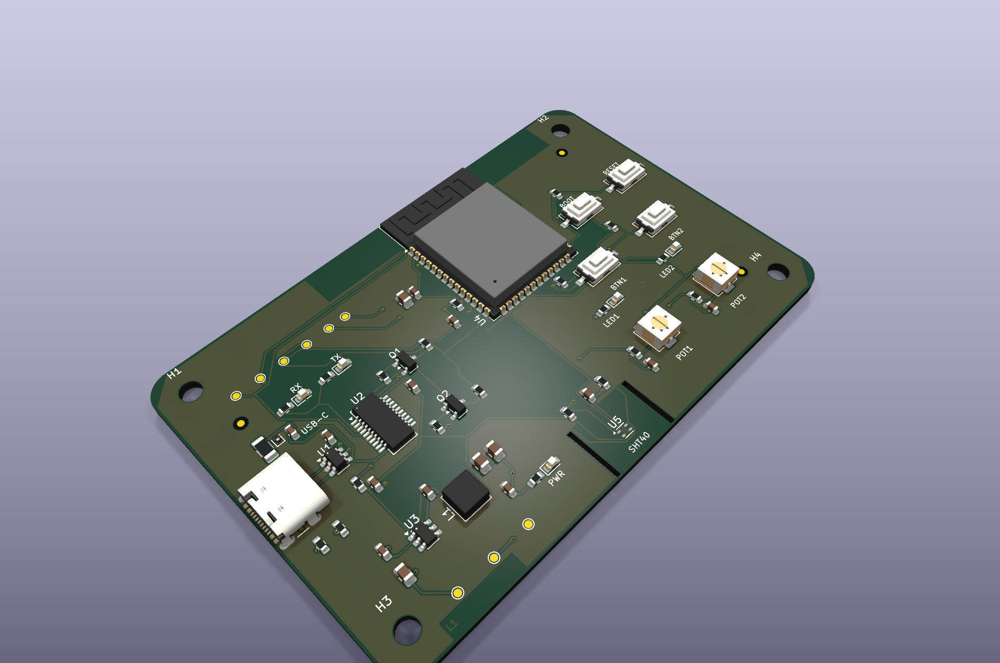
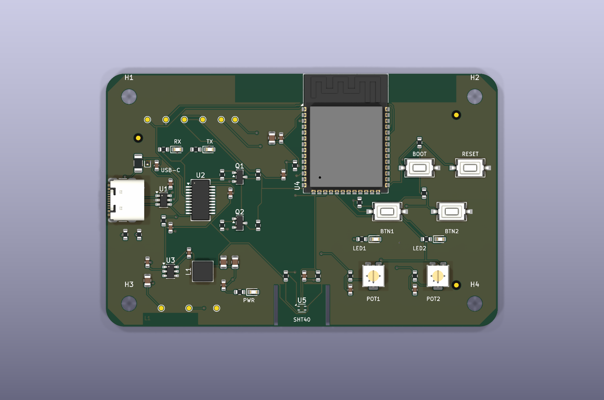
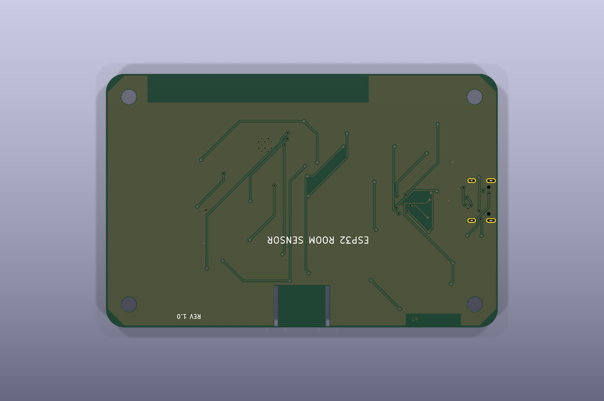

# ESP32 Room Sensor AI

An open-source ESP32-S3 room sensor and control board designed in KiCad 10. The board measures temperature and relative humidity and provides programmable buttons, potentiometers, LEDs, USB-C power, USB-UART communication and automatic firmware download/reset control.

## Features

- Espressif `ESP32-S3-WROOM-1-N8` with Wi-Fi and Bluetooth LE
- Sensirion `SHT40-AD1B-R2` temperature and humidity sensor on a thermally isolated PCB peninsula
- FTDI `FT231XS-R` USB-to-UART bridge with hardware RX/TX activity LEDs
- USB-C power and programming, USB ESD protection and resettable VBUS fuse
- Automatic ESP32 download/reset circuit plus dedicated BOOT and RESET buttons
- Two active-low user buttons, two 10 kΩ ADC potentiometers and two programmable LEDs
- AP63203 3.3 V synchronous buck supply
- Four-layer, 85 × 55 mm PCB with four M3 mounting holes
- Dedicated ESP32 antenna keepout and continuous inner GND reference plane

## PCB views

| Top | Bottom |
|---|---|
|  |  |

## Project files

- [Schematic PDF](docs/pdf/ESP32-Room-Sensor-Schematic.pdf)
- [Four-page PCB layer PDF](docs/pdf/ESP32-Room-Sensor-PCB.pdf)
- [Bill of materials](bom/KiCad_MCP_Test_BOM.csv)
- [GPIO map](docs/GPIO_MAP.md)
- [Design notes](docs/DESIGN_NOTES.md)
- [Verification record](docs/VERIFICATION.md)

Open `KiCad_MCP_Test.kicad_pro` with KiCad 10.0.8 or newer. The editable schematic and PCB sources are included; the PDF and PNG files are convenience release artifacts and do not replace the KiCad source.

## Verification status

The schematic ERC currently reports 0 errors and 0 warnings. KiCad-agentic's filtered DRC reports 0 active violations and 0 unconnected items. A fresh native KiCad CLI run that includes the current project rule set reports 323 geometric rule findings and 152 schematic/PCB field-parity findings. The geometric findings are dominated by 0.15 mm routed neck-downs against a 0.20 mm project minimum, clearance/hole rules and connector-edge geometry; the parity findings mainly concern footprint metadata. These findings are documented rather than silently suppressed and must be reviewed against the selected fabricator's rules before manufacturing.

USB differential impedance must be recalculated for the selected fabrication stackup. USB operation, RF/EMC performance and the assembled SHT40 temperature offset require first-article measurement. This repository is an engineering design release, not a certification or production approval.

## License

The creator-controlled hardware design sources and documentation are released under the [CERN Open Hardware Licence Version 2 — Strongly Reciprocal](LICENSE), SPDX identifier `CERN-OHL-S-2.0`. Third-party components, KiCad libraries, manufacturer models and trademarks remain subject to their respective terms.

---

# ESP32-kamersensor AI

Dit is een open-source ESP32-S3-kamersensor en bedieningsprint, ontworpen met KiCad 10. Het bord meet temperatuur en relatieve luchtvochtigheid en bevat programmeerbare knoppen, potentiometers en leds. Voeding, programmeren en seriële communicatie verlopen via USB-C.

## Functies

- Espressif `ESP32-S3-WROOM-1-N8` met wifi en Bluetooth LE
- Sensirion `SHT40-AD1B-R2` op een thermisch geïsoleerd PCB-schiereiland
- FTDI `FT231XS-R` USB-UART-bridge met echte hardwarematige RX/TX-indicatie
- USB-C, USB-ESD-beveiliging en een resetbare VBUS-zekering
- Automatische download/resetbesturing plus afzonderlijke BOOT- en RESET-knoppen
- Twee active-low gebruikersknoppen, twee 10 kΩ ADC-potmeters en twee programmeerbare leds
- AP63203 synchrone 3,3V-buckregelaar
- Vierlaagse PCB van 85 × 55 mm met vier M3-montagegaten
- ESP32-antennekeepout en een ononderbroken interne GND-referentielaag

## PCB-aanzichten

| Bovenkant | Onderkant |
|---|---|
|  |  |

## Projectbestanden

- [Schema als PDF](docs/pdf/ESP32-Room-Sensor-Schematic.pdf)
- [Vierpagina-PDF van de PCB-lagen](docs/pdf/ESP32-Room-Sensor-PCB.pdf)
- [Componentenlijst](bom/KiCad_MCP_Test_BOM.csv)
- [GPIO-toewijzing](docs/GPIO_MAP.md)
- [Ontwerpnotities](docs/DESIGN_NOTES.md)
- [Verificatierapport](docs/VERIFICATION.md)

Open `KiCad_MCP_Test.kicad_pro` met KiCad 10.0.8 of nieuwer. De bewerkbare schema- en PCB-bronnen zijn opgenomen; PDF- en PNG-bestanden zijn aanvullende release-artifacts.

## Verificatiestatus

De ERC van het schema rapporteert momenteel 0 fouten en 0 waarschuwingen. De gefilterde KiCad-agentic DRC rapporteert 0 actieve overtredingen en 0 niet-aangesloten items. Een nieuwe native KiCad CLI-run met de huidige projectregels rapporteert 323 geometrische regelmeldingen en 152 schema/PCB-veldpariteitsmeldingen. De geometrische meldingen bestaan hoofdzakelijk uit lokale 0,15mm-neckdowns tegenover een projectminimum van 0,20 mm, clearance-/gatregels en connectorgeometrie; de pariteitsmeldingen gaan vooral over footprintmetadata. Deze punten zijn bewust gedocumenteerd en moeten vóór fabricage aan de regels van de gekozen fabrikant worden getoetst.

De USB-impedantie moet opnieuw worden berekend voor de gekozen productiestackup. USB-functionaliteit, RF/EMC-prestaties en de temperatuur-offset van de gemonteerde SHT40 moeten op een eerste prototype worden gemeten. Deze repository is een engineering-release en geen certificering of productiegoedkeuring.

## Licentie

De door de ontwerper beheerde hardwarebronnen en documentatie vallen onder de [CERN Open Hardware Licence Version 2 — Strongly Reciprocal](LICENSE), SPDX-identificatie `CERN-OHL-S-2.0`. Componenten, KiCad-libraries, fabrikantmodellen en handelsmerken van derden behouden hun eigen voorwaarden.
